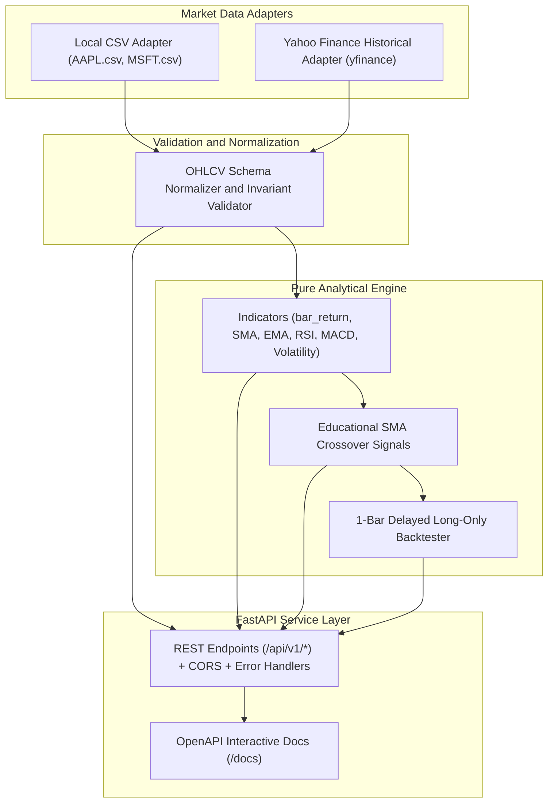

# Stock Market Data Analyzer

[](https://www.python.org/)
[](https://fastapi.tiangolo.com/)
[](https://pandas.pydata.org/)
[](https://docs.pytest.org/)

A full-stack stock market data analysis application with a Python and FastAPI backend and a Next.js dashboard. It loads historical OHLCV data from bundled CSV files or Yahoo Finance, calculates technical indicators, runs delayed-execution SMA crossover backtests, and provides watchlists, simulated portfolios, quote polling, and alerts.

The default CSV workflow runs without API credentials or an external database. The project is intended for educational use and software engineering demonstration, with explicit data provenance, validation, and backtest assumptions.

The project roadmap, deployment notes, and remaining limitations are documented in [docs/implementation-roadmap.md](docs/implementation-roadmap.md).

---

## Disclaimer: Educational Use Only

This software is provided strictly for educational, academic, and software engineering demonstration purposes. None of the market data, technical indicators, moving-average crossover states, or historical backtest simulations generated by this project constitute financial, investment, legal, or tax advice, nor do they represent price predictions or recommendations to buy, sell, or hold any security. Past historical performance does not guarantee future results.

---

## Executive and Technical Overview

### For Engineering Managers and Reviewers

Financial analytics prototypes frequently suffer from three engineering defects: tight coupling to a single fragile scraping script, silent corruption from malformed OHLCV records, and inflated backtest returns caused by look-ahead bias or mismatched annualization constants. Stock Market Data Analyzer addresses each concern systematically:

- **Vendor-Neutral Data Ingestion:** API routes communicate through a `MarketDataProvider` protocol rather than calling third-party libraries directly. Both a `YahooFinanceProvider` (for historical market series) and a deterministic `CSVMarketDataProvider` (for offline reproducible workflows and CI testing) normalize records into a single canonical schema.
- **Defensive Schema and Invariant Validation:** Every dataset is checked for required columns, valid ISO-8601 dates, duplicate timestamps, finite positive prices, non-negative volume, jagged CSV rows, and structural OHLC consistency (`low <= open <= high` and `low <= close <= high`). Invalid inputs fail fast with structured HTTP error codes.
- **Interval-Consistent Analytics and Look-Ahead-Safe Backtesting:** Across `1d`, `1wk`, and `1mo` intervals, per-bar returns (`bar_return`), annualized volatility, per-bar risk-free rate conversion, and Sharpe ratio scaling apply the exact annualization factor (`252`, `52`, or `12` periods per year). Strategy signals derived from bar `t`'s close fill at bar `t + 1`'s close (`execution_delay_bars = 1`, `execution_fill_convention = "next_bar_close"`), so new entries begin earning close-to-close returns on bar `t + 2` and exits earn through their bar `t + 1` close fill.
- **Honest Data Provenance:** API responses label the exact upstream source, `last_available_timestamp`, and `is_realtime: false` so historical or vendor-delayed bars are never misrepresented as live exchange feeds.

### Core Capabilities Implemented (Phase 1 Backend Foundation)

1. **Multi-Source OHLCV Ingestion (`backend/app/providers/`)**
   - Canonical schema normalization (`timestamp`, `open`, `high`, `low`, `close`, `volume`).
   - Yahoo Finance historical adapter supporting `1d`, `1wk`, and `1mo` intervals.
   - Local CSV adapter bundled with deterministic 840-bar multi-year sample datasets (`AAPL.csv`, `MSFT.csv`) supporting offline demonstration and `1d`, `1wk`, and `1mo` interval aggregation.
2. **Vectorized Technical Analysis (`backend/app/analysis/indicators.py`)**
   - Simple close-to-close per-bar returns (`bar_return`).
   - Simple Moving Average (SMA) and Exponential Moving Average (EMA).
   - Wilder Relative Strength Index (RSI, bounded `0` to `100`).
   - Moving Average Convergence Divergence (`macd_line`, `macd_signal`, `macd_histogram`).
   - Interval-aware annualized rolling return volatility (`sqrt(252)` for `1d`, `sqrt(52)` for `1wk`, `sqrt(12)` for `1mo`).
   - Strict warm-up handling: initial lookback rows remain `null` in JSON responses until full window observations exist.
3. **Educational Crossover Signal Engine (`backend/app/analysis/signals.py`)**
   - Evaluates fast vs. slow SMA relationships and emits discrete states (`WARMUP`, `BUY`, `SELL`, `NEUTRAL`) alongside continuous market regime labels (`WARMUP`, `BULLISH`, `BEARISH`, `NEUTRAL`).
4. **Long-Only SMA Crossover Backtester (`backend/app/analysis/backtest.py`)**
   - Next-bar-close fill convention (`execution_delay_bars = 1`): signals at bar `t` close fill at bar `t + 1` close (`executed_position = desired_position.shift(1)`), while bar `t` to `t + 1` returns accrue to the prior position (`earning_position = executed_position.shift(1)`).
   - Configurable initial capital, per-fill transaction cost in basis points applied at each fill event, and annual risk-free rate converted to an interval-accurate per-bar rate (`risk_free_rate_annual / periods_per_year`).
   - Outputs total return, buy-and-hold benchmark return, interval-annualized volatility, maximum peak-to-trough drawdown, interval-annualized Sharpe ratio, executed trade log, and per-bar equity curve.
5. **Frontend-Ready FastAPI Service (`backend/app/api/` and `backend/app/main.py`)**
   - Typed Pydantic v2 responses, standardized error envelopes, environment-configured CORS origins for local Next.js development, and interactive OpenAPI documentation at `/docs`.
6. **Persistence, Portfolios, Quotes, and Alerts (Phase 3 backend)**
   - SQLite storage through SQLAlchemy 2.x with Alembic migrations that run automatically at API startup.
   - Persistent watchlists, simulated paper portfolios with transactions and value and P&L summaries, optional scheduled quote polling, and persistent price and indicator alert rules with in-app events.

---

## System Architecture



---

## Project Structure

```text
stock-market-data-analyzer/
|-- backend/
|   |-- app/
|   |   |-- analysis/              # Indicators, crossover signals, and backtesting
|   |   |-- api/                   # FastAPI routes
|   |   |-- db/                    # SQLAlchemy models and database session
|   |   |-- providers/             # CSV and Yahoo Finance data adapters
|   |   |-- quotes/                # Optional quote provider integrations
|   |   `-- services/              # Portfolio, alert, and polling services
|   |-- data/sample/               # Deterministic AAPL and MSFT CSV datasets
|   |-- migrations/versions/       # Alembic database migrations
|   `-- tests/                     # Backend tests
|-- docs/
|   `-- implementation-roadmap.md
|-- frontend/
|   `-- src/
|       |-- app/                   # Next.js application pages
|       |-- components/            # Dashboard and feature components
|       `-- lib/                   # API client, types, and formatting
|-- images/
|   |-- .gitkeep                   # Keeps the screenshot directory in Git
|   `-- README.md                  # Screenshot filenames and capture guidance
|-- .env.example                   # Safe backend environment template
|-- .gitignore                     # Excludes local settings and generated files
|-- docker-compose.yml             # Local full-stack Docker setup
`-- README.md
```

---

## Screenshots and Visual Walkthrough

Screenshots are not included yet. The tracked [`images/`](images/) directory is ready for them; add the image files there and the links below will open them directly. See [images/README.md](images/README.md) for capture guidance and filenames.

| Screen | Image |
| :--- | :--- |
| FastAPI documentation | [01_swagger_api_docs.png](images/01_swagger_api_docs.png) |
| Market overview | [02_market_overview.png](images/02_market_overview.png) |
| Ticker analysis | [03_ticker_analysis.png](images/03_ticker_analysis.png) |
| Backtest results | [04_backtest_results.png](images/04_backtest_results.png) |
| Watchlists | [05_watchlists.png](images/05_watchlists.png) |
| Portfolio | [06_portfolio.png](images/06_portfolio.png) |

---

## Windows Setup and Run Instructions

### Prerequisites

- **Python 3.10 or newer** installed on Windows (`python --version`).
- No paid API keys, database servers, or external credentials are required.

### Step 1: Configure Optional Environment Variables

From the repository root in PowerShell, copy the tracked template to create a local `.env` file (automatically ignored by Git):

```powershell
Copy-Item .env.example .env
```

### Step 2: Create and Activate a Virtual Environment

```powershell
cd backend
python -m venv .venv
.\.venv\Scripts\Activate.ps1
```

If PowerShell blocks script execution on your machine, you can either run `Set-ExecutionPolicy -Scope Process -ExecutionPolicy Bypass` for the current terminal session or invoke `.\.venv\Scripts\python.exe` directly as shown below.

### Step 3: Install Dependencies

```powershell
.\.venv\Scripts\python.exe -m pip install -r requirements.txt
```

### Step 4: Start the FastAPI Server

Run from inside `backend/`:

```powershell
.\.venv\Scripts\python.exe -m uvicorn app.main:app --host 127.0.0.1 --port 8000 --reload
```

Once running:
- **Interactive Swagger UI:** `http://127.0.0.1:8000/docs`
- **ReDoc Specification:** `http://127.0.0.1:8000/redoc`
- **Health Check:** `http://127.0.0.1:8000/api/v1/health`

### Step 5: Run the Offline Automated Test Suite

From inside `backend/`:

```powershell
.\.venv\Scripts\python.exe -m pytest -v
```

All tests use local deterministic fixtures and mocked upstream adapters, requiring zero internet connectivity.

---

## API Reference and Expected Outputs

### Endpoint Summary

| Method | Path | Description |
| :--- | :--- | :--- |
| `GET` | `/api/v1/health` | Service status, active environment, and available offline CSV tickers |
| `GET` | `/api/v1/market-data/{ticker}` | Validated, sorted OHLCV bars with provenance and freshness metadata |
| `GET` | `/api/v1/indicators/{ticker}` | OHLCV bars enriched with `bar_return`, SMA, EMA, RSI, MACD, volatility, and signals |
| `GET` | `/api/v1/backtest/{ticker}` | 1-bar delayed long-only SMA crossover simulation, metrics, trades, and equity curve |

Phase 3 stateful endpoints (all under `/api/v1`, documented interactively at `/docs`):

| Area | Endpoints |
| :--- | :--- |
| Watchlists | `POST/GET /watchlists`, `DELETE /watchlists/{id}`, `POST /watchlists/{id}/items`, `DELETE /watchlists/{id}/items/{ticker}` |
| Portfolios | `POST/GET /portfolios`, `GET /portfolios/{id}` (value and P&L summary), `DELETE /portfolios/{id}`, `POST/GET /portfolios/{id}/transactions` |
| Quotes | `GET /quotes/status`, `POST /quotes/poll`, `GET /quotes/{ticker}` |
| Alerts | `POST/GET /alerts/rules`, `PATCH/DELETE /alerts/rules/{id}`, `POST /alerts/evaluate`, `GET /alerts/events`, `POST /alerts/events/{id}/acknowledge` |

Common query parameters on `{ticker}` routes:
- `source`: `csv` (offline deterministic sample data) or `yahoo` (Yahoo Finance historical API, default `yahoo`).
- `start_date`: Optional inclusive start date (`YYYY-MM-DD`).
- `end_date`: Optional inclusive end date (`YYYY-MM-DD`).
- `interval`: `1d` (default, `252` periods/year), `1wk` (`52` periods/year), or `1mo` (`12` periods/year).

### Example 1: Health Check

Request (PowerShell):

```powershell
Invoke-RestMethod "http://127.0.0.1:8000/api/v1/health" | ConvertTo-Json -Depth 4
```

Expected Output:

```json
{
  "status": "ok",
  "service": "Stock Market Data Analyzer API",
  "version": "0.1.0",
  "environment": "development",
  "available_csv_tickers": [
    "AAPL",
    "MSFT"
  ],
  "timestamp_utc": "2026-11-25T02:45:00Z"
}
```

### Example 2: Retrieve Normalized Market Data (Offline CSV)

Request:

```powershell
Invoke-RestMethod "http://127.0.0.1:8000/api/v1/market-data/AAPL?source=csv&start_date=2025-01-02&end_date=2025-01-08" | ConvertTo-Json -Depth 5
```

Expected Output (abbreviated):

```json
{
  "metadata": {
    "ticker": "AAPL",
    "interval": "1d",
    "source": "local_csv",
    "is_realtime": false,
    "last_available_timestamp": "2025-01-08",
    "bar_count": 5,
    "freshness_note": "Static historical OHLCV dataset loaded from local CSV storage. Offline deterministic data source; not real-time market data."
  },
  "disclaimer": "For educational and software demonstration purposes only. Historical data, technical indicators, crossover signals, and backtest metrics do not constitute financial advice, price predictions, or trade recommendations.",
  "bars": [
    {
      "timestamp": "2025-01-02",
      "open": 198.75,
      "high": 199.59,
      "low": 197.71,
      "close": 197.9,
      "volume": 64208229.0
    }
  ]
}
```

### Example 3: Compute Technical Indicators and Educational Signals

Request:

```powershell
Invoke-RestMethod "http://127.0.0.1:8000/api/v1/indicators/AAPL?source=csv&start_date=2025-01-02&end_date=2025-07-18&interval=1d&sma_fast=10&sma_slow=30" | ConvertTo-Json -Depth 5
```

Expected Output Structure (abbreviated):

```json
{
  "metadata": {
    "ticker": "AAPL",
    "interval": "1d",
    "source": "local_csv",
    "is_realtime": false,
    "last_available_timestamp": "2025-07-18",
    "bar_count": 142,
    "freshness_note": "Static historical OHLCV dataset loaded from local CSV storage. Offline deterministic data source; not real-time market data."
  },
  "parameters": {
    "interval": "1d",
    "periods_per_year": 252,
    "sma_fast_window": 10,
    "sma_slow_window": 30,
    "ema_window": 20,
    "rsi_window": 14,
    "macd_fast_window": 12,
    "macd_slow_window": 26,
    "macd_signal_window": 9,
    "volatility_window": 20,
    "warmup_policy": "Indicators require a full lookback window (min_periods = window). Initial warm-up rows remain null rather than backfilling or using partial windows."
  },
  "signal_summary": {
    "WARMUP": 29,
    "BUY": 1,
    "SELL": 1,
    "NEUTRAL": 111
  },
  "bars": [
    {
      "timestamp": "2025-01-02",
      "close": 197.9,
      "bar_return": null,
      "sma_fast": null,
      "sma_slow": null,
      "rsi": null,
      "signal": "WARMUP",
      "regime": "WARMUP"
    }
  ]
}
```

### Example 4: Run a Delayed-Execution Backtest

Request:

```powershell
Invoke-RestMethod "http://127.0.0.1:8000/api/v1/backtest/AAPL?source=csv&start_date=2025-01-02&end_date=2025-07-18&interval=1d&sma_fast=10&sma_slow=30&initial_capital=10000&transaction_cost_bps=10&risk_free_rate=0.02" | ConvertTo-Json -Depth 5
```

Expected Output Structure (abbreviated):

```json
{
  "assumptions": {
    "strategy_name": "Long-Only SMA Crossover",
    "interval": "1d",
    "periods_per_year": 252,
    "sma_fast_window": 10,
    "sma_slow_window": 30,
    "initial_capital": 10000.0,
    "execution_delay_bars": 1,
    "execution_fill_convention": "next_bar_close",
    "transaction_cost_bps": 10.0,
    "risk_free_rate_annual": 0.02,
    "risk_free_rate_per_bar": 0.00007937
  },
  "metrics": {
    "initial_capital": 10000.0,
    "final_equity": 12396.87,
    "total_return": 0.239687,
    "total_return_pct": 23.9687,
    "benchmark_buy_and_hold_return": 0.021273,
    "annualized_volatility": 0.068139,
    "max_drawdown": -0.010817,
    "sharpe_ratio": 5.3402,
    "trade_count": 1,
    "completed_round_trips": 0
  },
  "trades": [
    {
      "execution_timestamp": "2025-06-03",
      "signal_timestamp": "2025-06-02",
      "action": "BUY_ENTRY",
      "reference_close": 162.87,
      "cost_bps_applied": 10.0
    }
  ]
}
```

### Error Handling Contract

All invalid inputs, missing symbols, corrupt datasets, or upstream provider errors return a consistent JSON schema:

```json
{
  "error_code": "INVALID_REQUEST",
  "message": "sma_fast_window must be strictly smaller than sma_slow_window.",
  "details": {
    "sma_fast_window": 30,
    "sma_slow_window": 10
  }
}
```

Status code mapping:
- `400 Bad Request`: Invalid ticker format, reversed date bounds, or invalid window relationships.
- `404 Not Found`: Ticker symbol unavailable or zero bars within the requested date window.
- `422 Unprocessable Entity`: Corrupt OHLCV invariants, duplicate dates, non-numeric cells, or invalid query parameter types.
- `502 Bad Gateway`: Upstream Yahoo Finance network or service failure.

---

## Web Dashboard

The TypeScript and Next.js App Router interface consumes the FastAPI API. It does not recompute indicators, signals, or portfolio accounting in the browser.

### Start on Windows

Run the backend and frontend in separate PowerShell windows. The backend applies its SQLite migrations when it starts.

1. In PowerShell, start the backend from the repository root: `cd backend; .\.venv\Scripts\python.exe -m uvicorn app.main:app --host 127.0.0.1 --port 8000 --reload`
2. In another PowerShell window, start the dashboard from the repository root: `cd frontend; Copy-Item .env.example .env.local; npm ci; npm run dev`

Open http://localhost:3000. The default data source is the bundled offline CSV data, so the dashboard works without a market-data key.

### Dashboard Pages

- Overview: symbol, source, interval, and date filters; OHLCV chart; recent bars; data freshness.
- Ticker analysis: selectable SMA and EMA overlays, RSI, MACD, rolling volatility, crossover counts, and bar details.
- Backtest: configurable SMA windows and assumptions; equity and drawdown charts; executed order log; next-bar-close fills.
- Watchlists: persistent local lists and notes.
- Portfolio: simulated paper transactions, cash, holdings, fees, and estimated P&L.
- Alerts: price and indicator rules, event acknowledgement, and optional quote polling status.

The optional Finnhub quote key belongs in the root .env file as FINNHUB_API_KEY. Keep polling disabled until you intentionally enable it. Provider quotes are never marked guaranteed real-time.

### Docker Compose

If Docker Desktop is installed, run `docker compose up --build` from the repository root. The web app is available at http://localhost:3000 and the API at http://localhost:8000/docs. SQLite persists in a Docker volume. To enable optional polling, set FINNHUB_API_KEY in the shell or a local root .env file before starting Compose.

---

## Persistence, Portfolios, Quotes, and Alerts (Phase 3)

### Setup

No extra command is needed. Starting the API applies all Alembic migrations to the SQLite file at `backend/data/stock_analyzer.db` (gitignored). To apply them manually, run `.\.venv\Scripts\python.exe -m alembic upgrade head` from `backend/`. Install the new dependencies with the same `pip install -r requirements.txt` command as before.

### Behavior

- **Watchlists:** named lists of tickers with optional notes. Duplicate names or tickers return `409`.
- **Paper portfolios:** simulated only; no brokerage connection exists. Transactions use average-cost accounting with fees included in cost basis. Overselling (no short selling) and spending more than available paper cash are rejected with `400` and are not stored. If a trade omits `price`, the latest locally known price is used and its source is recorded on the transaction.
- **Valuation:** each holding is valued with the newest stored quote, otherwise the last CSV close, and labeled with `price_source`, `price_as_of`, and `price_is_realtime: false`. If any holding has no price, `valuation_complete` is `false` and totals are `null` rather than guessed.
- **Quote polling (optional):** disabled by default. It runs only when `FINNHUB_API_KEY` is set and `STOCK_ANALYZER_QUOTE_POLLING_ENABLED=true`. A background loop polls watchlist, active-alert, and portfolio tickers (capped per cycle), backs off exponentially on failures or rate limits, and evaluates alerts after each cycle. `POST /quotes/poll` triggers one cycle manually. Without a key everything else, including CSV analysis, works offline and `/quotes/poll` returns `503 PROVIDER_NOT_CONFIGURED`.
- **Freshness labels:** every stored quote keeps `fetched_at` (when this app received it) and `exchange_timestamp` (the provider's last-trade time). The API reports `freshness_status` as `recent`, `stale`, or `unknown`, plus `age_seconds`. `is_realtime` is always `false` because the free provider tier gives no real-time guarantee.
- **Alerts:** rule kinds are `price_above`, `price_below`, `rsi_above`, `rsi_below`, `sma_crossover_buy`, and `sma_crossover_sell`. An event fires only when a condition changes from false to true, at most once per `cooldown_minutes`. A transition blocked by the cooldown can still fire later if the condition remains true. Provider failures are reported in the evaluation result and never change rule state. Events carry the observation source and as-of time and can be acknowledged. Alerts are educational and are not advice.

### Quote Provider Choice and Terms

The optional provider is Finnhub (`GET /quote`, key sent in the `X-Finnhub-Token` header, response fields `c`, `o`, `h`, `l`, `pc`, `t`). Its free plan is documented at 60 calls per minute for personal use. Review the current terms at https://finnhub.io before relying on it, especially for anything beyond personal study. Alpha Vantage was not chosen because its free tier is limited to 25 requests per day and it reserves real-time and delayed US equity data for paid entitlements.

---

## Methodology, Limitations, and Data Freshness

1. **Data Source and Latency Limitations:**
   - `yahoo_finance_historical` relies on `yfinance`, an open-source wrapper around public Yahoo Finance endpoints. It is not an exchange-licensed feed, may experience rate limiting or upstream schema changes, and provides historical or delayed bars rather than real-time ticks.
   - `local_csv` reads static files stored on disk (`backend/data/sample/`) for deterministic offline analysis and testing.
   - Real-time or scheduled quote polling with explicit exchange-delay tracking is scoped to Phase 3 in [docs/implementation-roadmap.md](docs/implementation-roadmap.md).
2. **Interval Annualization and Warm-Up Policy:**
   - Supported intervals map to explicit annualization constants: `252` periods/year for `1d`, `52` periods/year for `1wk`, and `12` periods/year for `1mo`.
   - Rolling indicators (`SMA`, `EMA`, `RSI`, `MACD`, `rolling_volatility`) enforce `min_periods = window`. Rows prior to lookback completion serialize as `null` to avoid misleading partial-sample estimates.
3. **Backtest Execution Convention and Simplifications:**
   - **Next-Bar-Close Fill (`execution_delay_bars = 1`):** A signal calculated from bar `t`'s close fills at bar `t + 1`'s close (`reference_close = close[t + 1]`). The return from bar `t`'s close to bar `t + 1`'s close belongs to the position held prior to that fill: new entries begin earning close-to-close returns starting on bar `t + 2`, while exits continue earning returns through the bar `t + 1` close fill and stop thereafter.
   - Proportional transaction costs (`transaction_cost_bps`, default `10.0` bps) are applied at each close fill event via `(1 + gross_return) * (1 - cost_rate) - 1`, and Sharpe ratio uses a constant annual risk-free rate (`risk_free_rate_annual`, default `2.0%`, converted to `risk_free_rate_annual / periods_per_year` per bar).
   - Market impact, bid-ask spread widening, intraday open-auction fills, short selling, dividend reinvestment taxes, and survivorship bias across delisted tickers are not modeled in Phase 1.
4. **Phase 3 Limitations:**
   - SQLite is single-user and local; there is no authentication, so do not expose the API publicly.
   - Paper portfolios are not tax or brokerage accurate and use a single average-cost method.
   - Polled quotes are provider data without a real-time guarantee, and markets may be closed. Sample CSV prices are synthetic.
   - Indicator alerts evaluate daily bars, so they change at most once per trading day. The `yahoo` alert source needs network access.
   - The dashboard is a single-user local application with no authentication or account sync.

---

## Security and Version Control Hygiene

- Zero API keys, passwords, tokens, or paid vendor credentials exist in source code.
- Runtime configuration is read from environment variables with safe local defaults documented in `.env.example`.
- Local `.env` files, Python virtual environments (`.venv/`), bytecode caches (`__pycache__/`), test caches (`.pytest_cache/`), and local databases are excluded via `.gitignore`.
