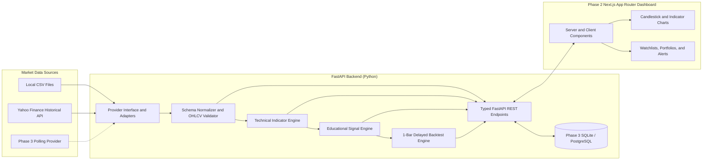
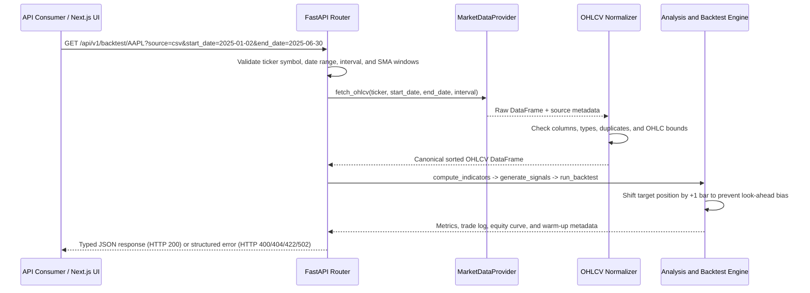

# Stock Market Data Analyzer: Implementation Roadmap

## 1. Purpose and Scope

Stock Market Data Analyzer is a modular, student-friendly market analytics platform engineered with production-grade software boundaries. The system ingests historical OHLCV (Open, High, Low, Close, Volume) data from local CSV files and Yahoo Finance, validates and normalizes records into a canonical schema, computes standard technical indicators and educational rule-based signals, executes a look-ahead-safe backtest, and exposes all capabilities through a typed FastAPI REST interface designed for a Next.js App Router frontend.

Educational Notice: All indicators, signals, and backtest metrics generated by this software are strictly for academic study and software engineering demonstration. Nothing in this system constitutes financial advice, price prediction, or a recommendation to buy or sell securities.

---

## 2. System Architecture

The platform separates data acquisition, domain computation, API transport, persistence, and user interface concerns into independent layers so each component can be tested, replaced, or extended without breaking downstream consumers.

### Key Architectural Boundaries

1. **Provider Abstraction (`backend/app/providers/`):**
   Routes never call `yfinance` or file parsers directly. Instead, endpoints request data through a `MarketDataProvider` interface (`CSVMarketDataProvider`, `YahooFinanceProvider`). Adding a new market vendor in a later phase requires implementing a single `fetch_ohlcv` method.
2. **Canonical Normalization and Validation (`normalizer.py`):**
   Every provider returns raw tabular records to a shared normalizer that enforces required columns (`timestamp`, `open`, `high`, `low`, `close`, `volume`), valid ISO-8601 dates, finite positive prices, non-negative volume, unique timestamps, and structural OHLC consistency (`low <= open <= high`, `low <= close <= high`, `low <= high`).
3. **Pure Analytical Domain Layer (`backend/app/analysis/`):**
   Indicator calculations, crossover states, and portfolio backtesting operate exclusively on validated `pandas.DataFrame` inputs and have zero FastAPI or HTTP dependencies.
4. **Explicit Data Freshness Labeling:**
   Every API payload declares `source`, `is_realtime: false`, `last_available_timestamp`, and a `freshness_note` so delayed or static historical bars are never misrepresented as real-time exchange quotes.

---

## 3. End-to-End Data Flow

---

## 4. Phased Delivery Plan

### Phase 1: Backend Data Ingestion, Technical Analysis, and API Foundation (Current Slice)

**Objective:** Establish a self-contained, verified Python backend under `backend/` with offline testability and clean REST contracts.

- **Package and Environment Setup:**
  - Structured Python package (`backend/app/`) with `pyproject.toml`, `requirements.txt`, and environment-driven configuration via `.env.example` and `python-dotenv`.
  - Zero paid dependencies, API keys, or hardcoded secrets.
- **Market Data Ingestion:**
  - `MarketDataProvider` protocol decoupling vendor retrieval from domain logic.
  - `YahooFinanceProvider` built on `yfinance.Ticker.history` for historical OHLCV retrieval (`1d`, `1wk`, `1mo`).
  - `CSVMarketDataProvider` backed by deterministic local sample CSV datasets (`AAPL.csv`, `MSFT.csv`) so development, grading, and automated tests run completely offline.
  - Strict validation surfacing actionable error messages for missing symbols, empty date ranges, duplicate dates, non-numeric cells, and broken OHLC invariants.
- **Technical Analysis and Backtesting:**
  - Indicators: Simple per-bar returns (`bar_return`), Simple Moving Average (SMA), Exponential Moving Average (EMA), Wilder Relative Strength Index (RSI), Moving Average Convergence Divergence (MACD line, signal line, histogram), and interval-aware annualized rolling volatility (`252` periods/year for `1d`, `52` for `1wk`, `12` for `1mo`).
  - Warm-up rows explicitly preserved as `null` (`NaN` internally) until each indicator reaches its full lookback window.
  - Educational SMA crossover signal generator emitting `WARMUP`, `BUY`, `SELL`, and `NEUTRAL` discrete signals alongside continuous `BULLISH` / `BEARISH` regime tags.
  - Long-only SMA crossover backtester using a next-bar-close fill convention (`execution_delay_bars = 1`: signals at bar `t` close fill at bar `t+1` close, entries begin earning close-to-close returns on bar `t+2`, exits earn through the bar `t+1` close fill), deducting configurable transaction costs in basis points at each fill event, converting the annual risk-free rate into an interval-consistent per-bar rate, and reporting total return, annualized volatility, maximum drawdown, Sharpe ratio, and executed trade count.
- **FastAPI Layer and Verification:**
  - Endpoints: `/api/v1/health`, `/api/v1/market-data/{ticker}`, `/api/v1/indicators/{ticker}`, and `/api/v1/backtest/{ticker}`, plus OpenAPI Swagger UI at `/docs`.
  - Configurable CORS origins via `STOCK_ANALYZER_CORS_ORIGINS` (defaulting to local Next.js dev ports `http://localhost:3000` and `http://127.0.0.1:3000`).
  - Offline `pytest` test suite covering normalization, invalid fixtures, mathematical indicator properties, look-ahead prevention, and HTTP error mapping.

---

### Phase 2: Next.js App Router Dashboard

**Objective:** Build an interactive, responsive web frontend under `frontend/` consuming the Phase 1 FastAPI contracts without duplicating financial math in browser code.

- **Framework Architecture (Next.js App Router + TypeScript):**
  - Route layout under `frontend/src/app/`:
    - `/` - Market overview, quick ticker search, data source selector (`csv` vs `yahoo`), and educational disclaimer banner.
    - `/ticker/[symbol]` - Dedicated workspace featuring interactive candlestick + volume charts, overlay toggles (SMA fast/slow, EMA), lower panes (RSI, MACD, rolling volatility), and signal markers.
    - /backtest - Parameterized strategy lab allowing students to adjust fast/slow SMA windows, date ranges, and transaction cost assumptions while inspecting the equity curve, drawdown chart, and trade table.
    - /watchlists - Persistent named watchlists and ticker notes.
    - /portfolio - Simulated paper transactions, holdings, valuation, and P&L summary.
    - /alerts - Alert rules and events, acknowledgements, and quote-polling status.
- **Data Fetching and State Strategy:**
  - Typed API client generated or aligned with FastAPI OpenAPI schemas (`/openapi.json`).
  - Server Components for initial shell and metadata; Client Components with URL search-param synchronization (`?source=csv&fast=10&slow=30`) so analysis views are bookmarkable and reproducible.
  - Explicit freshness badges rendered directly from `source`, `is_realtime`, and `last_available_timestamp` returned by the API.
- **CSV Upload Workflow (Optional UI Extension):**
  - Multipart upload endpoint (`POST /api/v1/datasets/upload`) validating user-supplied CSV files through the existing normalizer before rendering charts.

---

### Phase 3: Persistence, Scheduled Quote Polling, Portfolios, and Alerts

**Objective:** Introduce stateful user workflows and documented near-real-time quote polling while preserving strict honesty around data latency.

**Implementation status (backend and local dashboard implemented):**

- Done in the backend: SQLAlchemy 2.x models and an Alembic migration (`backend/migrations/versions/0001_initial_schema.py`) for watchlists, paper portfolios and transactions, quote snapshots, and alert rules and events; REST endpoints for all of them; optional Finnhub quote polling with exponential backoff, a per-cycle symbol cap, and rate-limit handling; stored `fetched_at` and `exchange_timestamp` with `recent`, `stale`, and `unknown` freshness labels (never real-time); alert evaluation with false-to-true edge detection and cooldown suppression; and offline tests in `backend/tests/test_phase3.py`.
- Deviations from the plan below: Finnhub is the single implemented provider (Alpha Vantage and Alpaca are not implemented); polling uses an asyncio background task instead of APScheduler; the `price_cache` table is not built because stored quote snapshots serve that role for now; alert delivery is in-app only with no webhook or email adapter.
- Done in the frontend: responsive overview, ticker analysis, backtest, watchlists, paper portfolio, and alerts pages. The interface uses the existing API contracts and defaults to offline CSV samples. Lint, type checking, and a production build are verified locally.

- **Relational Persistence Layer:**
  - SQLite for zero-configuration local student setups (with SQLAlchemy 2.x + Alembic migrations compatible with PostgreSQL for hosted deployments).
  - Core tables:
    - `watchlists` and `watchlist_items` (tracked symbols, notes, preferred intervals).
    - `portfolios` and `transactions` (simulated paper-trading lots, cost basis, cash ledger, realized/unrealized P&L).
    - `price_cache` (cached historical bars keyed by `(provider, ticker, interval, timestamp)` to minimize redundant upstream requests and rate-limit errors).
    - `alert_rules` and `alert_events` (threshold conditions such as `close >= target_price`, `rsi <= 30`, or `sma_crossover == BUY`).
- **Quote Polling Provider and Freshness Guarantees:**
  - Separate `QuotePollingProvider` interface supporting free-tier REST quote APIs (for example Finnhub, Alpha Vantage, or Alpaca Market Data free IEX feed configured via `.env` keys).
  - Background polling scheduler (APScheduler or FastAPI lifespan task) respecting provider rate limits with exponential backoff.
  - Every quote record stores `fetched_at_utc`, `exchange_timestamp_utc`, and `expected_delay_minutes` so delayed quotes (15-minute delayed or end-of-day) are clearly distinguished from true real-time feeds.
- **Alert Evaluation Engine:**
  - Idempotent rule evaluator triggered after each polling cycle, recording triggered events in `alert_events` with cooldown windows to prevent duplicate notifications, surfaced via an in-app notification drawer and optional webhook/email adapter.

---

### Phase 4: Documentation, Visual Artifacts, Hardening, and GitHub Delivery

**Objective:** Finalize portfolio presentation, end-to-end verification, and reproducible deployment packaging.

**Implementation status:** CI workflow, Dockerfiles, Docker Compose, local setup documentation, and the dashboard are implemented. Backend tests and frontend lint, type checks, and production build have passed locally. Real application screenshots and a final manual visual review remain; publishing to GitHub requires a configured remote and is not part of local implementation.

- **Engineering Hardening:**
  - Continuous Integration workflow (`.github/workflows/ci.yml`) executing `pytest` for `backend/` and `eslint` + `tsc --noEmit` + a production build for `frontend/` on every push and pull request.
  - Docker Compose profile (`docker-compose.yml`) orchestrating `backend` and `frontend` with healthchecks and `.env.example` templates.
- **Documentation and Architecture Artifacts:**
  - Full API reference table, architecture diagrams, indicator formula reference, and explicit discussion of statistical and data limitations (survivorship bias, corporate action adjustments, slippage, look-ahead pitfalls).
  - Capture real screenshots under `images/` and link them from the root `README.md` (Swagger `/docs`, market overview, ticker chart and indicators, backtest results, watchlists, and portfolio).
- **GitHub Repository Delivery Standards:**
  - Clean commit history, comprehensive `.gitignore` excluding virtual environments, `.env` secrets, caches, and local databases, plus clear onboarding steps for technical reviewers, hiring managers, and first-time contributors.
